<p align="center">  </p> <p align="center"><br><br> <em>A complete audio player built with GTK3 and GStreamer... but a bit of a video player too.</em> <p align="center">
  
</p><br> <p align="center"> <strong><a href="https://github.com/MilOvni/Myostoox/raw/refs/heads/main/myostoox_1.4-4_all.deb">📦 Download Myostoox 1.4.4 (.deb)</a></strong> </p><br> 

# Myostoox

<br>Myostoox is an **audio and video player** designed primarily for *Debian XFCE Trixie* and *Lubuntu 26.04 LTS*, while also working on other Linux desktop environments using **GTK**, including **LXQt** and **XFCE**.

Built with Python 3, GTK3 and GStreamer, and developed with AI assistance, Myostoox brings music, video, Internet radio, TV/M3U playlists and optical media together in a single application.<br><br><br><br>


<p align="center">
  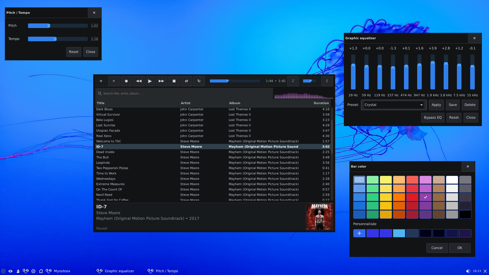
</p>

<br><br>
## **Feature**s<br><br>
### **Audio**

    • Local music playback

    • Internet radio

    • M3U / M3U8 / PLS playlists

    • Scrobbling — ListenBrainz / Last.fm

    • Audio CD playback

    • Audio recording of streams in MP3 format at 320kbps VBR

    • Equalizer

    • Pitch and tempo control

    • Normalization (ReplayGain)

    • Crossfade / Gapless

    • Sleep timer
    
    • 3 Spectrum analyzer (Bars, Oscilloscope, Pixel)

    • LRC lyrics

    • Metadata and track information

    • MPRIS2 support

    • Desktop notifications

### **Video**

    • Local video playback

    • Subtitles

    • Full-screen playback

    • Video playlists

    • TV / IPTV M3U playlists

    • Playback speed : 0.5x , 0.75x , 1.0x (normal) , 1.25x , 1.50x , 1.75x

    • Video playback resume support

    • Export screenshots to BMP

    • Automatic screen-blanking inhibition during playback

    • Custom handling for some MKV / E-AC3 playback cases

### **Radio, TV & playlists**

    • Internet radio stations

    • TV / IPTV bouquets

    • M3U / M3U8 / PLS import and export

    • Playlist persistence

    • Missing files are clearly identified

    • Files opened from the file manager can be sent to an already running Myostoox instance

### **Optical media**

    • Audio CDs

    • DVDs

    • Blu-rays (experimental)

### **Interface**

    • Mini-player (with scrolling banner)

    • Nano-player (with playlist)

    • Themes

    • Hide navigation controls

    • Full-screen mode

    • Maximize mode

    • Borderless window mode 

    • Spectrum analyzer + Color choice + Spectrum synchronization

    • Transparency effect

    • MPRIS2 integration

    • GTK3 interface designed for lightweight Linux desktops

### **Supported Formats**

    • Audio: .mp3, .flac, .wav, .aac, .m4a, .wma, .ogg, .oga, .opus, .wv, .aif, .aiff, .dts
    
    • Video & Containers: .mp4, .mkv, .avi, .webm, .mov, .mpeg, .mpg, .ac3
    
    • Playlists & IPTV: .m3u, .m3u8, .pls
    
    • Lyrics: .lrc, .txt


## **Languages**

Myostoox is available in **13 languages** (menu **Appearence → Language**):

| | |
|---|---|
| English | Français |
| Deutsch | Castellano |
| Italiano | Nederlands |
| Português | Polski |
| Svenska | Русский |
| 简体中文 | 한국어 |
| 日本語 | |

The interface language is remembered between sessions.

<br>
<br>


## Screenshots

<p align="center">
  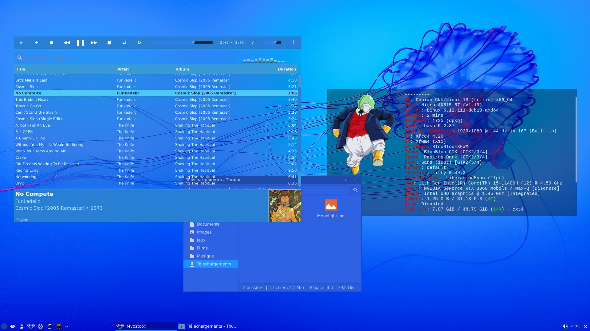
</p>

<p align="center">
  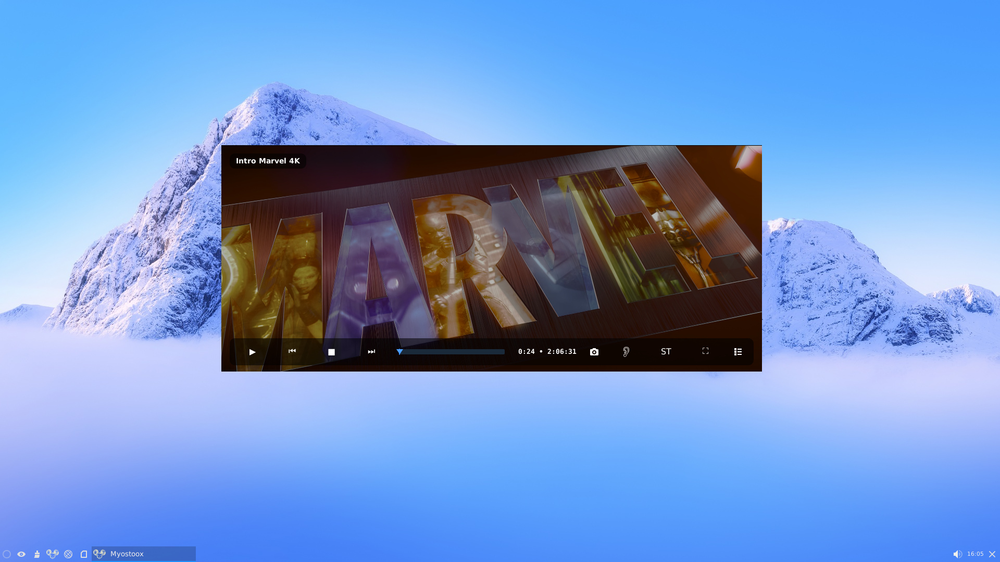
</p>

<p align="center">
  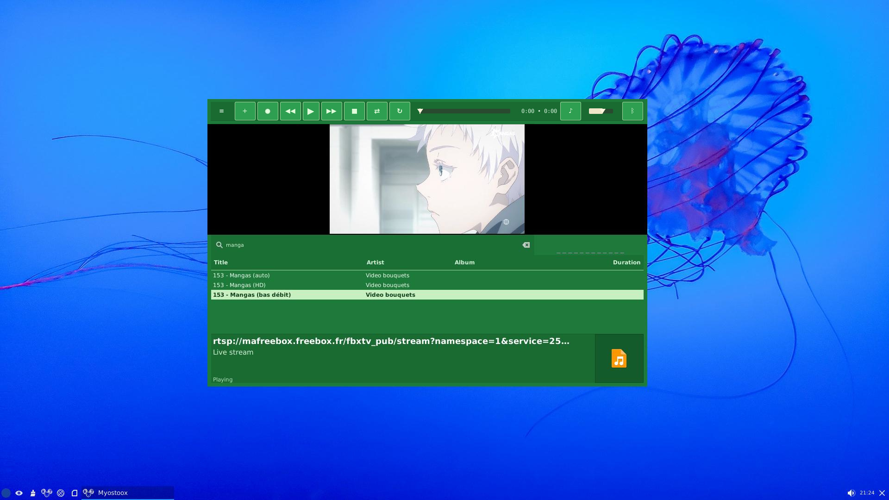
</p>

<p align="center">
  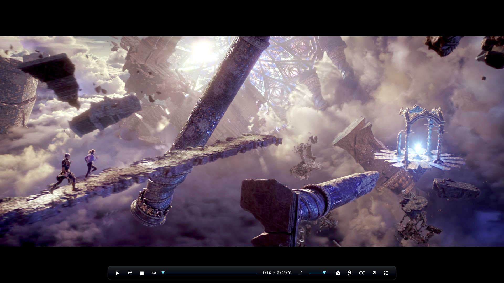
</p>

<p align="center">
  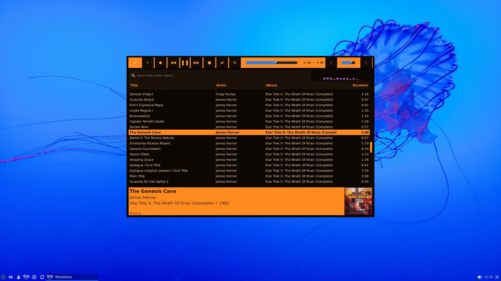
</p>

<p align="center">
  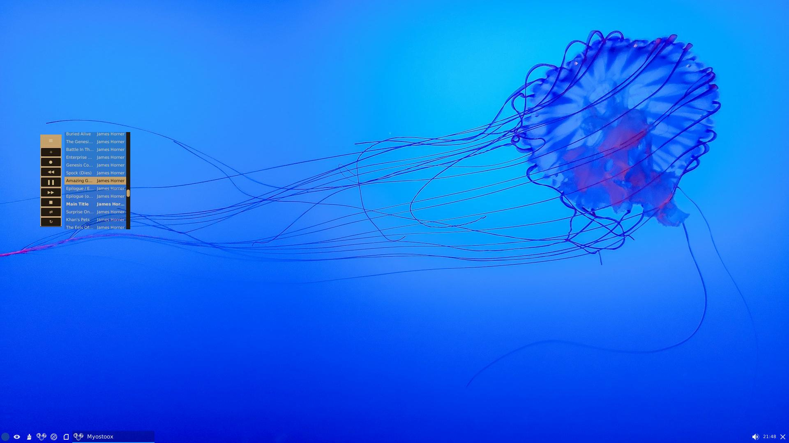
</p>

<p align="center">
  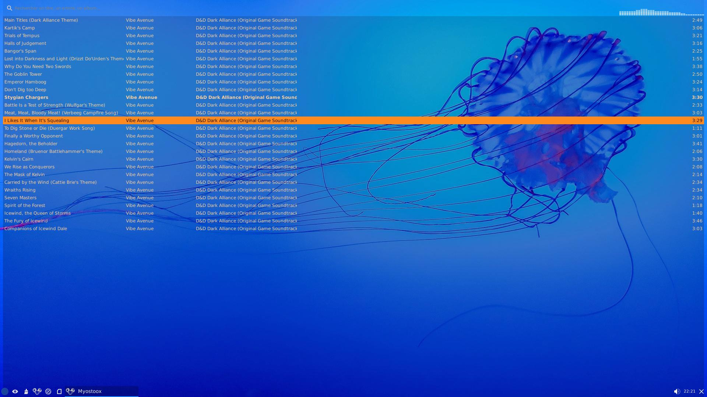
</p>

<p align="center">
  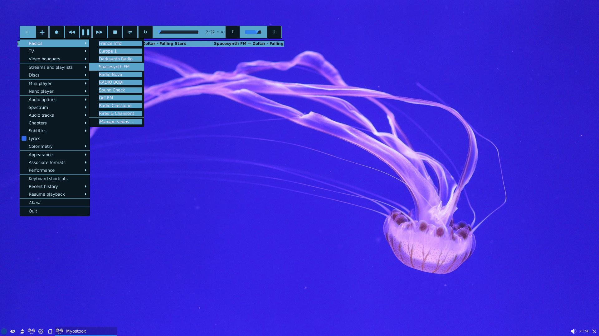
</p>

<p align="center">
  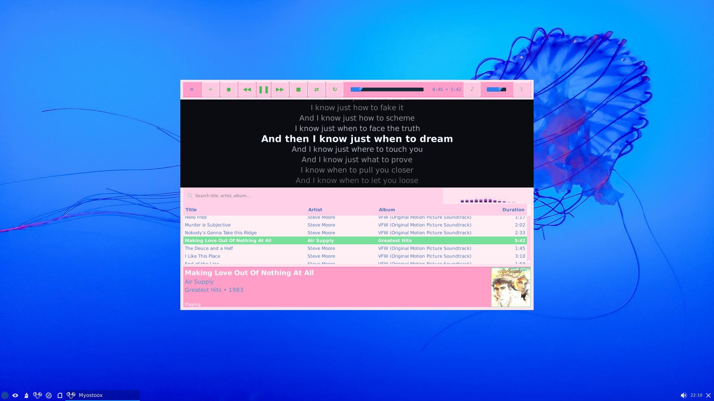
</p>

<p align="center">
  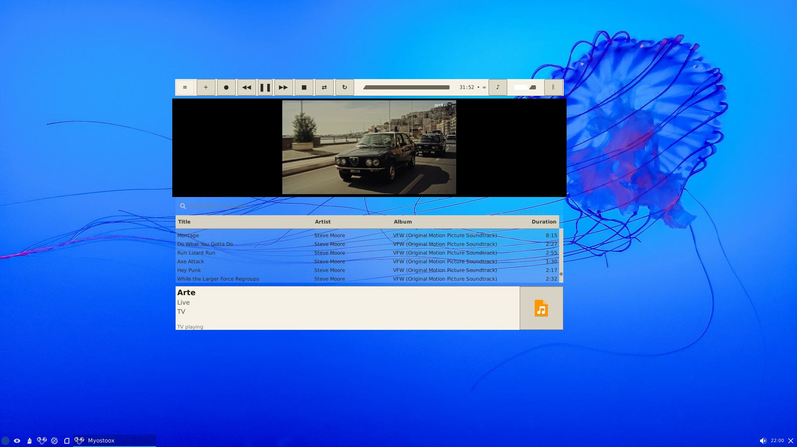
</p>


---

<br>

## 📦 Installation

### Debian / Ubuntu / Lubuntu

Download the `.deb` package:

<p align="center">
  <strong><a href="https://github.com/MilOvni/Myostoox/raw/refs/heads/main/myostoox_1.4-4_all.deb">📦 Download Myostoox 1.4.4 (.deb)</a></strong>
</p>

From the directory containing the deb package, open a Terminal and install the application with one of the following commands:

```bash
sudo apt install ./myostoox_1.4-4_all.deb

# or

sudo dpkg -i myostoox_1.4-4_all.deb

```

### From source

Clone the repository:

```bash
git clone https://github.com/MilOvni/Myostoox.git
cd Myostoox
```

Then launch:

```bash
python3 Myostoox.py
```

Or:

```bash
chmod +x Myostoox.py
./Myostoox.py
```

## Dependencies

### Required

```bash
sudo apt update && sudo apt install -y \
  python3 python3-gi python3-gi-cairo python3-cairo \
  gir1.2-gtk-3.0 gir1.2-gst-plugins-base-1.0 gir1.2-gstreamer-1.0 \
  gir1.2-gdkpixbuf-2.0 gir1.2-pango-1.0 gir1.2-notify-0.7 \
  gstreamer1.0-tools \
  gstreamer1.0-plugins-base \
  gstreamer1.0-plugins-good \
  gstreamer1.0-plugins-bad \
  gstreamer1.0-plugins-ugly \
  gstreamer1.0-libav \
  gstreamer1.0-gl \
  gstreamer1.0-x \
  gstreamer1.0-alsa \
  gstreamer1.0-pulseaudio \
  gstreamer1.0-gtk3 \
  gstreamer1.0-vaapi \
  python3-mutagen \
  libnotify4 \
  libdvd-pkg libdvdread8t64 libdvdnav4 libbluray2 \
  ubuntu-restricted-extras
```

### Strongly recommended (Lubuntu / XFCE)

```bash
# Audio CD
sudo apt install libcdio-dev libcdio-paranoia2

# Encrypted CSS DVDs
sudo dpkg-reconfigure libdvd-pkg

# Intel GPUs
sudo apt install -y mesa-va-drivers vainfo

# NVIDIA GPUs
sudo ubuntu-drivers autoinstall
```

### Optional

```bash
# DVD / Blu-ray (depending on local legality and firmwares)
libaacs0 + KEYDB.cfg (commercial Blu-rays)
```


## Launching

```bash
python3 Myostoox.py
# or
chmod +x Myostoox.py
./Myostoox.py
```

Files passed as arguments (Thunar, double-click) are sent to the already running instance if one exists.

Configuration: `~/.config/Myostoox/` (playlist, state, radios, themes…).<br>


<p align="center">
  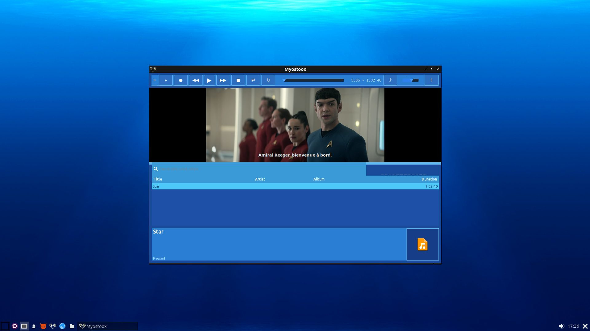
</p>
<br>

---

## Menu — useful new features

| Entry | Purpose |
|-------|---------|
| **Import / Export playlist…** | `.m3u` / `.m3u8` / `.pls` files |
| **Mini-player** | Transport bar only, always on top & optional scrolling title |
| **Lyrics** | Displays `.lrc` / `.txt` / tags (audio only) |

- **Missing file**: absent tracks (unplugged USB) appear in *italics* with ⚠.
- **Screen blanking**: automatically inhibited during **video playback** (via `org.freedesktop.ScreenSaver`).
- **Notifications**: title / artist on every track change (if `libnotify` is installed).

---

## Myostoox — Keyboard Shortcuts

> All shortcuts are customizable via **Menu → Keyboard shortcuts** (saved in `state.json`).

## Playback

| Key | Action |
|---|---|
| `Space` | Play / Pause (plays the selected track if it differs from the current one) |
| `M` | Mute / Unmute |
| `Ctrl` + `↑` | Volume up (+5 %) |
| `Ctrl` + `↓` | Volume down (−5 %) |

## Seeking

| Key | Action |
|---|---|
| `←` / `→` | −5 s / +5 s |
| `J` / `L` | −10 s / +10 s |
| `Page Up` / `Page Down` | −30 s / +30 s |

## Video

| Key | Action |
|---|---|
| `F11` or `F` | Toggle fullscreen (video or lyrics) |
| `Esc` | Exit fullscreen |
| `F12` | Screenshot (video only) |

## Playlist

| Key | Action |
|---|---|
| `↑` / `↓` | Move selection up / down |
| `Shift` + `↑` / `↓` | Extend selection |
| `Delete` | Remove selected item(s) |
| `F1` | Clear playlist |
| `Ctrl` + `P` | Open playlist context menu |
| `Ctrl` + `R` | Focus the search field |
| `Ctrl` + `N` | Player hidden or shown |


## Streams

| Key | Action |
|---|---|
| `Ctrl` + `S` | Start / stop recording (radio, TV, bouquet or URL stream → MP3 320 kb/s) |

## Application

| Key | Action |
|---|---|
| `Alt` + `Q` | Quit |
| `Ctrl` + `Alt` + `X` | Quit and factory reset |

## Multimedia keys (always active, not remappable)

| Key | Action |
|---|---|
| `XF86AudioPlay` / `XF86AudioPause` | Play / Pause |
| `XF86AudioStop` | Stop |
| `XF86AudioNext` / `XF86AudioPrev` | Next / Previous track |
| `XF86AudioMute` | Mute |
| `XF86AudioRaiseVolume` / `XF86AudioLowerVolume` | Volume ±5 % |

## Notes

- While a text field has focus (e.g. the search box), single-key shortcuts are disabled so you can type freely.
  Only **Quit**, **Factory reset**, **Playlist menu**, **Focus search** and **Recording** still work there.
- Nano-player playlist: `↑` / `↓` to navigate, `Enter` to play the selected track.
- Mouse: double-click a playlist row to play it; double-click the video area to toggle fullscreen.
- Playlist multi-selection: `Ctrl` + click / `Shift` + click.
- MPRIS2 (D-Bus) is also exposed, so desktop media controls work as well.

---

## Quick troubleshooting

| Symptom | Hint |
|---------|------|
| No sound / unknown format | Install `gstreamer1.0-plugins-ugly` and `gstreamer1.0-libav` |
| Silent or crashing MKV E-AC3 | The internal custom MKV pipeline handles this case; check `gstreamer1.0-libav` |
| No notifications | `sudo apt install gir1.2-notify-0.7` |
| CD not detected | `libcdio` + ugly plugins; make sure it is a real audio CD (not data) |
| Screen turns off during a movie | Check that the session exposes the ScreenSaver D-Bus interface (XFCE does) |

---

## Screen blanking / sleep under LXQt

Myostoox tries to inhibit screen blanking during **video playback** via D-Bus  
(`org.freedesktop.ScreenSaver`, then `org.freedesktop.PowerManagement.Inhibit`).

Under **LXQt** (Lubuntu), these services are often missing: this is not a playback bug.  
To prevent the screen from turning off during a movie:

1. **Settings → Power Management (LXQt)** (`lxqt-config-powermanagement`)
2. Extend or disable screen blanking / sleep
3. Optional: install a D-Bus-compatible screensaver provider

`ServiceUnknown` messages related to ScreenSaver / Notifications are silently ignored.

---

## License / usage

This project is free software distributed under the **GNU General Public License version 3** (GPL-3.0).

See the [`LICENSE`](LICENSE) file for the full text.

Use in accordance with local laws (DVD/Blu-ray, stream sources).

---

## Inspirations

 **AIMP**<br>
 **Winamp**<br>
 **Audacious**<br>
 **DeaDBeeF**<br>
 **VLC**<br>
 **mpv**<br>
 **SMPlayer**<br>
 ...<br>

---

## Author(s)

**O. FRAISSE (MilOvni)** & (AI) **Grok**

GitHub — MilOvni/Myostoox<br><br>


<p align="center">
  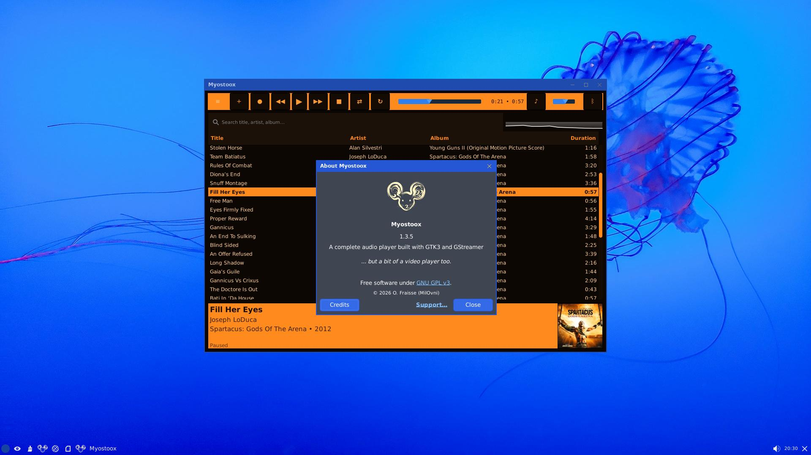
</p>
<br>

```
